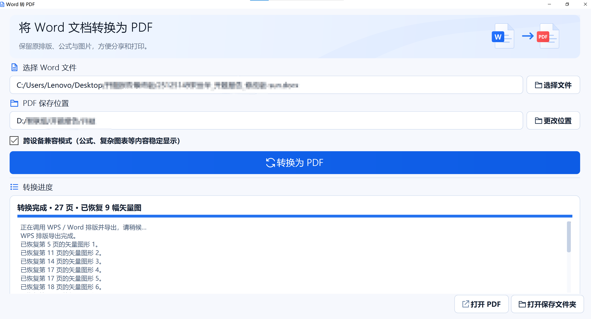

<div align="center">

# Word to PDF

### 面向 SVG 矢量图与公式的 Word 转 PDF 工具


**改善 Word 中的 SVG 经 WPS 导出 PDF 后变模糊的问题，让图中文字和线条保持矢量清晰度。**

[效果展示](#效果展示) · [快速开始](#快速开始) · [源码部署](#源码部署) · [问题反馈](#问题反馈) · [后续计划](#后续计划)

</div>

## 为什么做这个工具

写论文、开题报告或技术文档时，我们常把 SVG 流程图、架构图和曲线图插入 Word。它们在文档中很清晰，但有时使用 WPS 转换为 PDF 后，整幅图被转成位图，放大后就出现锯齿、像素块和模糊文字。

这个项目针对这一场景，在本机 Word / WPS 完成排版导出后，提取 DOCX 中的原始 SVG，并尽量按图片原有的尺寸、位置和裁切范围恢复 PDF 中的矢量内容，输出对应的 PDF 文件。

**工具完全免费，本地运行，不需要注册，也不需要把文档上传到服务器。**

## 效果展示

### 图一：桌面工具

选择 Word 文件、选择保存位置，然后点击 **转换为 PDF**。支持文件拖入、进度显示、结果打开、窗口自适应与高分屏显示。



### 图二：部分 WPS 导出结果，放大后出现像素与锯齿

下面是用户提供的实际对比截图。原本清晰的图中文字和圆角边框，在 PDF 中放大后变得模糊。


### 图三：恢复矢量内容后，放大仍然清晰

对于能够恢复的原始 SVG，文字轮廓、线条和图形以矢量形式写入 PDF，可以得到图三所示的保真效果。


[下载局部矢量 PDF 示例](examples/vector-output-demo.pdf)，可以在 PDF 阅读器中放大观察。示例只包含对比区域，不包含完整个人报告。

> 这里的“无损”指可恢复 SVG 的矢量清晰度与图形保真，不代表任意 Word、任意对象都能数学意义上完全无损。截图不能凭空变成原始矢量图；兼容模式可能将渐变简化为普通填色，并把公式转成字形轮廓。图片、字体与复杂版式的支持范围见[已知限制](#已知限制)。

## 已有功能

| 功能 | 当前支持情况 |
| --- | --- |
| Word 转 PDF | 支持 `.docx`、`.doc`、`.docm`，依赖本机 WPS 或 Microsoft Word |
| SVG 矢量恢复 | 对能定位到对应图片的 DOCX / DOCM 内嵌 SVG 进行恢复 |
| 原有版式 | 使用文字处理程序排版，尽量保留分页、表格、图片尺寸和裁切 |
| 数学公式兼容 | 将可识别的数学字体字形转成矢量轮廓，降低跨设备乱码风险 |
| 图形兼容 | 简化部分 SVG 渐变，减少不同阅读器显示不一致的问题 |
| 桌面操作 | 文件拖放、转换进度、结果打开、自动避开同名文件 |
| 清晰界面 | 字号与控件随窗口大小缩放，适配 Windows 高分屏 |
| 本地处理 | 不修改原 Word，不上传文档，转换过程无需联网 |

当前人工核验样例：一份 **27 页**报告，恢复 **9 幅 SVG**，兼容处理 **466 个数学字形**。这是具体样例的测试结果，不代表覆盖所有文档与阅读器。

## 快速开始

### 直接使用 EXE

1. 在本仓库的 **Releases** 中下载发布包，并解压到本地文件夹。发布包需由维护者先创建，源码 ZIP 本身不包含 EXE。
2. 确认电脑已经安装 **WPS 文字或 Microsoft Word**，并且可以正常打开待转换文件。
3. 双击 `Word转PDF.exe`。
4. 点击 **选择文件**，或把 Word 文件拖入窗口。
5. 选择 **PDF 保存位置**，通常保留勾选 **跨设备兼容模式**。
6. 点击 **转换为 PDF**，完成后点击 **打开 PDF** 查看结果。

Windows 10 / 11 64 位环境下使用。发布包无需另装 Python；WPS / Microsoft Word 需要自行安装。

本机定制版默认保存到 `D:\360Downloads\pdf转换`。其他电脑请在界面中改为实际存在且可写的保存目录。已有同名 PDF 会自动添加序号，原文件不会被覆盖。

### 两种处理方式

| 方式 | 适合场景 | 需要了解 |
| --- | --- | --- |
| 勾选跨设备兼容模式 | 在电脑、iPad 等设备间查看，优先保证外观一致 | 公式转为轮廓后，复制、搜索或编辑公式可能不完整；部分渐变会简化 |
| 取消勾选 | 希望保留原字体与渐变表现 | 仍尝试恢复 SVG，但公式字体与图形效果需要在目标阅读器中检查 |

## 源码部署

### 1. 准备环境

- Windows 10 / 11，64 位。
- Python **3.13**，64 位。
- 本机 WPS 文字或 Microsoft Word。

下载本项目源码并解压，在项目根目录打开 PowerShell：

```powershell
py -3.13 -m venv .venv
.\.venv\Scripts\python.exe -m pip install --upgrade pip
.\.venv\Scripts\python.exe -m pip install -r requirements.txt
```

### 2. 启动界面

```powershell
.\.venv\Scripts\python.exe src\word_pdf_app.py
```

### 3. 打包成 EXE

```powershell
.\.venv\Scripts\python.exe -m pip install -r requirements-dev.txt
.\.venv\Scripts\python.exe -m PyInstaller --noconfirm WordToPDF.spec
```

程序生成在 `dist\Word转PDF.exe`。也可以运行 `scripts\build.ps1` 完成依赖安装与打包。详细说明见[部署文档](docs/DEPLOYMENT.md)。

### 4. 可选命令行调用

```powershell
.\.venv\Scripts\python.exe src\word_pdf_app.py --convert "C:\Docs\report.docx" --output-dir "C:\Docs\PDF" --result-json "C:\Docs\result.json"
```

默认启用兼容处理。追加 `--standard` 可保留数学字体和渐变。命令行模式仍需要图形环境和本机 Office 软件，不是无界面的服务器转换服务。

## 转换原理


无法可靠对应位置的图形会保留排版引擎的导出内容；没有原始矢量信息的位图不会自动描摹。渲染检查用于发现无法正常打开或绘制的页面，不等同于保证与原文逐像素一致。

## 问题反馈

请通过本仓库顶部的 **Issues → New issue** 反馈问题。已提供“转换问题”和“功能建议”模板。

[提交转换问题或功能建议](../../issues/new/choose)

为了便于复现，请尽量提供：

- Windows 版本，以及 WPS / Word 的版本。
- 工具版本或所使用的发布包名称。
- 输入格式、是否勾选兼容模式、发生问题的页码。
- 预期效果、实际截图、可复现的操作步骤。
- 转换日志中的相关内容。

文档含个人信息或未公开研究内容时，**请先脱敏**，尽量提交只包含问题页面的最小样例。不要在公开 Issue 中上传完整私人报告。重复问题可以在已有 Issue 中补充信息。

想参与改进？欢迎提交 PR，步骤与建议见 [CONTRIBUTING.md](CONTRIBUTING.md)。

## 已知限制

- 当前只支持 Windows，不能直接在 macOS / Linux 或未安装文字处理程序的服务器上使用。
- SVG 恢复主要针对 DOCX / DOCM 的可匹配内嵌图片；旧 `.doc`、浮动图形、OLE 等对象不保证能够恢复矢量内容。
- 位图、截图和照片保留已有清晰度，不能通过更换扩展名获得无限放大能力。
- 特殊字体、复杂公式、异常 SVG、扩展裁切等情况仍可能需要人工处理。
- 兼容模式会对部分视觉效果作转换，重要文件请核对排版，并在最终使用的设备上确认。
- **目前尚未实现 PDF 转 Word。** 后续功能不会在实现前标记为已支持。

## 后续计划

这是一个**完全免费的工具**。后续会继续完善转换质量、兼容性和使用体验，围绕大家通过 GitHub 反馈的问题持续迭代。

- [ ] 改善更多 WPS / Word 版本的 SVG 导出兼容性。
- [ ] 完善字体、数学公式与不同 PDF 阅读器的显示支持。
- [ ] 增加批量转换、任务队列和更易读的错误提示。
- [ ] 扩大脱敏测试样例和自动化回归验证范围。
- [ ] 探索 **PDF 转 Word**，逐步保留可编辑文字、表格和版式。
- [ ] 根据反馈扩展更多文档、图片与 PDF 格式转换。

以上为迭代方向，具体支持范围与发布时间以实际发布说明为准。

## 项目结构

```text
word-to-pdf/
├── README.md                 # 项目首页与效果对比
├── LICENSE                   # AGPL-3.0 许可证
├── THIRD_PARTY_NOTICES.md     # 主要依赖及许可说明
├── requirements.txt          # 运行依赖
├── requirements-dev.txt      # 打包依赖
├── WordToPDF.spec             # 可移植的 EXE 打包配置
├── src/                      # 转换引擎与桌面界面
├── scripts/                  # 构建、发布打包与文档检查
├── docs/                     # 部署、发布说明与截图
├── examples/                 # 局部矢量 PDF 示例
├── licenses/                 # 随项目附带的依赖许可文本
└── .github/                  # Issue / PR 模板与构建工作流
```

本地 EXE、生成的 PDF、日志、旧版备份与临时文件不纳入源码版本管理。EXE 通过 Releases 分发。如何上传现有目录、准备发布包，见[发布说明](docs/PUBLISHING.md)。

## 许可证与致谢

本项目按 [GNU AGPL v3](LICENSE) 提供源码。免费使用不等于无许可约束；修改和再分发请遵守相应许可证。

感谢 [PyMuPDF](https://github.com/pymupdf/PyMuPDF)、[PyQt5](https://www.riverbankcomputing.com/software/pyqt/)、[fontTools](https://github.com/fonttools/fonttools)、[pypdf](https://github.com/py-pdf/pypdf) 与 [PyInstaller](https://github.com/pyinstaller/pyinstaller)。依赖保留其各自许可证，详见 [THIRD_PARTY_NOTICES.md](THIRD_PARTY_NOTICES.md)。

如果这个工具帮你保住了报告中的一张清晰矢量图，欢迎点一个 Star，也欢迎用 Issue 帮它变得更好。
